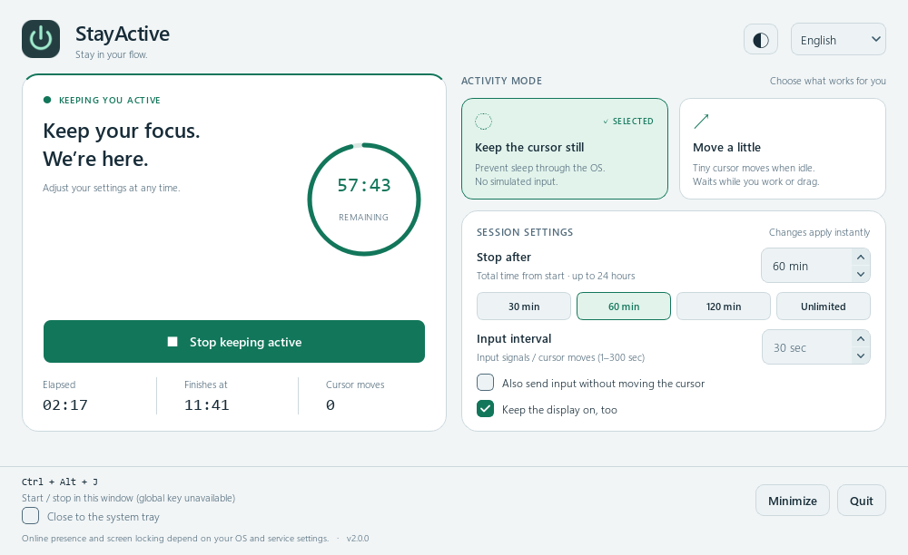

# StayActive 2.0.0 — 2026-10-28

## 実行と安全な終了

| 旧版で確認した問題 | 修正 |
| --- | --- |
| 共有フラグと `sleep()` のループ。停止直後に再開すると旧スレッドも復帰して重複実行する。 | 実行ループを廃止。単一 `QTimer` と明示的なセッション状態に統一。100 回の開始・停止後も動作は 1 回。 |
| グローバルキーボードフックから GUI を別スレッドで直接変更する。登録失敗でアプリも起動できない。 | Windows `RegisterHotKey` と Qt のネイティブイベントで UI スレッドへ統一。競合時はウィンドウ内ショートカットに切替。終了時に解除。 |
| スレッド開始時に取得した間隔とモードが固定され、UI と実際の動作が一致しない。 | 検証済み設定を一元管理し、動作中の変更を即時反映。 |
| 言語切替でコンボボックスの選択が初期化される。翻訳文字列でモードを比較するため実行も誤判定する。 | `quiet` / `cursor` の固定 ID を使用。翻訳は表示だけを変更。 |
| `SetThreadExecutionState` を明示的に解除しない。API の失敗を検出しない。 | UI スレッドで取得・変更・解除。API 戻り値を検査し、解除失敗も成功表示にしない。 |
| `SendInput` の共用体がマウス構造体のみで、ABI サイズが正しくない。戻り値も検査しない。 | キーボード・ハードウェアを含む正しい共用体へ修正。x64 は 40 bytes をテスト。入力の戻り値を検査。 |
| 人が作業中でもランダム移動で割り込む。画面端・フェイルセーフの例外で、停止状態と UI が食い違う。 | Windows の実入力アイドル時間とマウスボタンを確認。微小な相対入力を交互に送信。例外は維持要求を解除して停止し、画面に理由を表示。 |
| macOS で短命な `caffeinate` を反復生成し、維持に空白ができる。Linux の抑止要求を蓄積する。 | セッション単位の所有プロセスを管理。終了時に回収し、親終了でも維持を残さない構造へ変更。 |
| ウィンドウの閉じる操作でワーカーやホットキーを整理しない。 | 閉じる・終了・アプリ終了に共通の冪等なクリーンアップを実装。 |
| ファイルロックの失敗で開いたハンドルを漏らし、解除後のファイル削除にも競合がある。 | `QLockFile` に置換。クラッシュ後の回復とユーザー単位のローカルソケットによる既存画面の復帰。 |
| 不明な `STAYACTIVE_LANG` が辞書参照エラーになる。無効な数値入力を画面上に残す。 | 入力の範囲・型・言語を検証。数値入力を `QSpinBox` に統一。 |
| ビルド時に共用 Python の PyQt5、キャッシュ、ユーザーの site-packages を削除する。 | プロジェクト専用 venv に限定。テストに失敗するとビルドを中断。 |
| 配布物の起動検証で、開発環境の PATH にある別製品の DLL が混入し、QtCore のインポートに失敗した。 | DLL の探索先を Python・Qt・Windows に限定。UCRT / API-set は Windows 10/11 のシステム実装を使用。ビルドの最後に実際の EXE 起動と終了を必須化。 |

## UI / UX

- 状態、残り時間リング、経過時間、終了予定、カーソル動作回数を集約した画面へ刷新。
- 自動停止は 30 / 60 / 120 分のプリセット、1〜1440 分の任意入力、無制限。時間は開始からの合計で計算し、イベント処理が遅れても期限後に入力を送らない。
- 起動時は停止状態。設定の変更とセッションの開始を分離し、次回起動時の意図しない維持を防止。
- 日本語 / 英語とダーク / ライトテーマ、設定の永続化、ユーザー別の回転ログ。
- 広い画面は左右 2 列、狭い画面はスクロール。ショートカットと終了操作を下部に固定。
- 選択状態、キーボードフォーカス、数値入力の矢印、チェック状態、アクセシブルな名前を整備。
- システムトレイ、状態別アイコン、終了通知、既存画面への復帰。閉じるとトレイへ入る挙動は明示的なオプション。
- キーボードフック、不要な `keyboard` / `psutil`、Windows の PyAutoGUI 依存を削除。
- Windows の移動量ゼロの入力信号を明示的な追加オプションとして保持。初期状態は OS のスリープ抑止のみ。入力オプションを有効にした場合だけ信号を送る。
- 入力送信時の左上緊急停止を 250ms ごとに確認し、最大 300 秒の動作間隔が停止を遅らせないよう修正。
- 「検出不能」「必ずオンライン維持」といった保証できない説明を撤去し、実際に制御する範囲を明記。

## 検証

- Python 3.13.4 / PyQt 6.9.1 と、独立環境の Python 3.12.14 / PyQt 6.11.0 で回帰テスト。
- 61 件の自動テスト。ネイティブ API の構造と引数の検査、ホットキー処理、ロックのクラッシュ回復、GUI の操作と終了、公開アカウントの検証と誤ったコミット名義の拒否を含む。
- Windows 11 で `SetThreadExecutionState` を実呼び出しし、システム・ディスプレイ維持フラグ `0x80000003` の取得と解除を確認。
- 日本語ダーク / 英語ライト / 幅 560px の描画を確認。1000×612px の表示では縦横スクロールなし、560×540px では横スクロールなし。
- Windows EXE をビルドし、専用 `--smoke-test` で起動・同梱 SVG・正常終了を検証。
- Windows で実際のウィンドウ表示とアクセシビリティツリーを確認。最終版のトレイやグローバルホットキーを手動操作で一巡する確認は未実施。
- GitHub Actions で Windows / macOS / Ubuntu × Python 3.11 / 3.13 の6構成、および Windows 配布 EXE のビルドと起動確認が成功。macOS / Linux の実デスクトップ上でのスリープ抑止は未検証。

