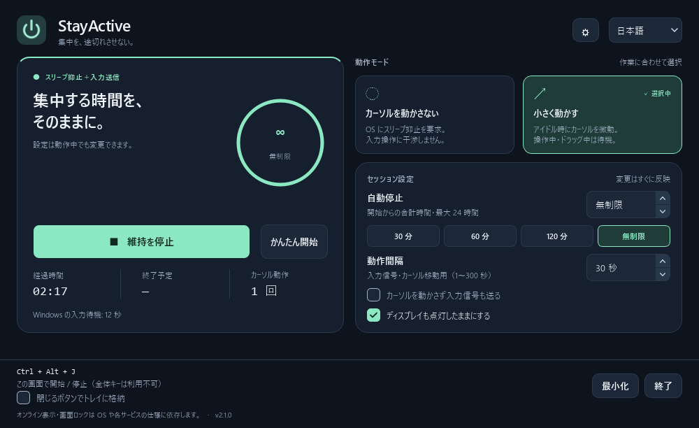

# StayActive 2.1

集中している間、PC の自動スリープを抑止する小さなデスクトップアプリです。日本語 / English、ダーク / ライトに対応しています。設定とログは端末内に保存します。



## 起動

Windows x64 向けは [最新リリースの StayActive.exe](https://github.com/Tomonari-Works/StayActive/releases/latest/download/StayActive.exe) をダウンロードしてください。Python のインストールは不要です。[リリース一覧・変更点・チェックサム](https://github.com/Tomonari-Works/StayActive/releases)も確認できます。

旧版から更新するときは、起動中の StayActive を終了してから EXE を置き換えてください。2.0 では初期状態が「カーソルを動かさない」「60 分で自動停止」です。従来の移動なし入力信号は Windows の追加オプションとして選択できます。

ソースをビルドした場合の出力先は `dist/StayActive.exe` です。`jiggler.bat` はこのファイルを優先して起動します。

### Windows のかんたん開始

開始ボタンの横の **「かんたん開始」** を押すと、カーソル微動・30 秒間隔・無制限・画面点灯をまとめて設定して開始します。30 秒以上入力がない場合だけごく小さくカーソルを往復させ、操作中・ドラッグ中は送信を待機します。再度押しても維持処理は重複しません。停止ボタン、`Ctrl+Alt+J`、アプリ内の `Esc` で停止できます。

通常の開始ボタンは保存した設定を使います。起動時に自動で維持を開始することはありません。「かんたん開始」は Windows のスリープ抑止と入力送信の両方が利用できる場合に表示します。

**「Windows の入力待機」** は、この Windows セッションで最後の入力から何秒経過したかを示します。開始後に約 1 秒ごとに更新し、入力内容や待機時間の履歴は保存・送信しません。この数値や送信回数は、他アプリのオンライン状態を検証した結果ではありません。

ソースから起動する場合は、Python 3.10 以降の標準インストールを使ってください。

```powershell
python -m venv .venv
.venv\Scripts\python -m pip install -r requirements.txt
.venv\Scripts\python main.py
```

macOS / Linux では `.venv/bin/python` を使用します。Windows では PyQt6 だけで動作し、キーボードフックや管理者権限は不要です。macOS / Linux のカーソル移動には PyAutoGUI もインストールされます。

## 操作

1. 維持モードと自動停止までの時間を選択します。初期値は「カーソルを動かさない」「60 分」です。
2. 「アクティブ維持を開始」を押します。残り時間・経過時間・終了予定が表示されます。
3. 停止ボタン、`Ctrl+Alt+J`、またはアプリ内の `Esc` で停止します。

| 設定 | 動作 |
| --- | --- |
| カーソルを動かさない | OS の機能で自動スリープを抑止。初期状態ではマウス・キーボード入力を生成しません。 |
| 小さく動かす | 一定のアイドル時間が経過するとカーソルを微動。Windows ではキー入力中・マウス操作中は待機します。 |
| 自動停止 | 30 / 60 / 120 分、無制限、または 1〜1440 分を指定。実行中の変更も開始時点からの合計時間に適用します。 |
| 動作間隔 | 入力信号・カーソル移動用。1〜300 秒。実行中に反映します。 |
| カーソルを動かさず入力信号も送る | Windows の移動なしモード用オプション。アイドル時に移動量ゼロのマウス入力を送信。初期値はオフ。オンライン表示の維持はサービスに依存します。 |
| ディスプレイの点灯 | オフにすると、システムの自動スリープだけを抑止します。Windows / macOS に対応。 |
| 閉じるボタンでトレイに格納 | 初期値はオフ。オンにすると閉じても維持を継続します。「終了」は常に維持を停止して終了します。 |

- Windows の `Ctrl+Alt+J` は他アプリの操作中も利用できます。競合する場合や他の OS では、このアプリ内のショートカットに切り替わり、画面下部に表示されます。
- トレイのアイコンをクリックすると復帰します。右クリックから表示 / 開始・停止 / 終了を操作できます。
- 二重起動すると既存のウィンドウを表示します。クラッシュ後のロックも回復します。
- Windows で入力を送信する設定は、画面左上 `(0, 0)` で緊急停止します。動作間隔によらず 250ms ごとのタイマーで確認します。他 OS では PyAutoGUI のフェイルセーフを使用します。
- 表示言語・テーマ・動作設定・ウィンドウ位置を保存します。次の起動時に維持を自動再開することはありません。
- ウィンドウ幅 900px 以上は 2 列、狭い場合は縦並びです。下部のショートカットと終了操作は常に表示されます。

## OS ごとの対応と実際の範囲

| OS | スリープ抑止 | カーソル移動 | 検証 |
| --- | --- | --- | --- |
| Windows | `SetThreadExecutionState`。開始と停止を同じ UI スレッドで実行し、停止・終了時に解除。 | ネイティブ `SendInput`。移動あり / 移動なしを選択。実際の入力のアイドル時間・マウスボタン状態を確認。 | Windows 11 でテスト・API 実呼び出し・EXE 起動確認。 |
| macOS | OS 付属の `caffeinate` をセッションごとに 1 プロセス起動。親プロセスの終了でも解除。 | PyAutoGUI。カーソル位置の変化を監視。アクセシビリティ権限が必要になる場合があります。 | プロセス制御の自動テスト。実機検証は未実施。 |
| Linux | `systemd-inhibit` が必要。実行環境と権限に依存。画面の点灯維持は対象外。 | X11 の PyAutoGUI。Wayland は非対応として無効化。 | プロセス制御の自動テスト。実機検証は未実施。 |

アプリの対象は自動スリープの抑止です。画面ロック・スクリーンセーバー・チャットのオンライン表示は OS やサービスの仕様に依存します。旧版の「100% undetectable」「絶対に離席にならない」という説明は実装上保証できないため改めました。手動スリープや電源ボタン操作を妨げる機能はありません。

### 常時アクティブにする方法の選び方

| 方法 | 適している用途 | 限界 |
| --- | --- | --- |
| OS の電源設定 | アプリを常駐させず自動スリープを抑止 | 元の設定に戻す必要があり、操作中・在席表示は維持しない |
| PowerToys Awake / StayActive の入力なしモード | 必要な間だけ、OS にスリープ抑止を要求 | 入力待機時間や他アプリの在席表示とは別 |
| StayActive のかんたん開始 | スリープ抑止と OS の入力送信を一操作で併用 | Windows 用。マウスが微動し、UIPI・セッション・サービス独自の判定に依存 |
| Web ページ | ページを表示している間の画面点灯維持 | 別タブ・最小化で Screen Wake Lock が解除される |
| Chrome 拡張の power API | ブラウザー稼働中の自動スリープ抑止 | Windows の入力待機時間を更新する機能ではない |
| 外付け入力デバイス | 対応環境で OS への入力を生成 | 機器の接続が必要。各アプリの独自在席判定まで保証しない |

あらゆるアプリの在席状態を一律に制御する API はありません。例えば Slack の `users.setPresence` は `auto` / `away` の切り替えであり、`auto` は常時オンラインの固定ではありません。Teams は操作状況・会議・カレンダー・他端末も参照します。したがって、本アプリを含め「全アプリで必ずオンライン」を保証する方法として案内することはできません。

仕様の参照先: [Microsoft PowerToys Awake](https://learn.microsoft.com/en-us/windows/powertoys/awake)、[Windows SendInput と UIPI](https://learn.microsoft.com/en-us/windows/win32/api/winuser/nf-winuser-sendinput)、[GetLastInputInfo](https://learn.microsoft.com/en-us/windows/win32/api/winuser/nf-winuser-getlastinputinfo)、[Chrome power](https://developer.chrome.com/docs/extensions/reference/api/power)、[Screen Wake Lock](https://www.w3.org/TR/screen-wake-lock/)、[Slack の在席設定](https://docs.slack.dev/reference/methods/users.setPresence/)、[Teams の在席判定](https://learn.microsoft.com/en-us/microsoftteams/presence-admins)。

## 設定とログ

Windows の保存先は通常 `%LOCALAPPDATA%\TomonariWorks\StayActive` です。macOS / Linux では Qt のユーザー別アプリデータフォルダーを使用します。

- `settings.ini`: 設定とウィンドウ位置。壊れた値は検証して補正します。
- `stayactive.log`: エラーの診断用。256KB × 最大 3 ファイルに制限します。
- `instance.lock`: 多重起動防止用。アプリが管理します。

## 開発・検証

```powershell
.venv\Scripts\python -m unittest discover -v
.venv\Scripts\python main.py --smoke-test
```

70 件の自動テストで、開始・停止の連打、遅延復帰、実行中の設定変更、タイマー満了、失敗時の解除、設定破損、翻訳、レイアウト、クラッシュ後のロック回復、ホットキーの競合と解除、公開用の認証ガードを検証します。テストから OS へマウス入力は送りません。OS 固有のテストは他の OS ではスキップします。

`--smoke-test` は一時フォルダーを使い、通常の設定を変更せず、起動・同梱 SVG の読み込み・正常終了を検証します。維持は開始しません。GitHub Actions には Windows / macOS / Ubuntu、Python 3.11 / 3.13 のテストを設定しています。ローカルでの確認内容は [CHANGELOG.md](CHANGELOG.md) に記載しています。

UI のプレビュー生成例:

```powershell
$env:QT_QPA_PLATFORM = 'offscreen'
.venv\Scripts\python tools/render_preview.py --output .artifacts/preview.png
```

プレビューは模擬バックエンドを使います。実際のスリープ抑止やカーソル入力は実行しません。

## Windows EXE のビルド

```powershell
.\build.bat
```

プロジェクト専用 `.venv` に依存をインストールし、テスト → アイコン生成 → ライセンス収集 → PyInstaller → 配布 EXE の起動・終了確認を実行します。Windows ビルド用の依存は `constraints-build.txt` で固定します。いずれかが失敗すると停止します。DLL 探索も Python・Qt・Windows の標準フォルダーに限定し、他製品の DLL 混入を防ぎます。共用 Python のパッケージ削除、pip キャッシュの削除は行いません。標準ライブラリの `venv` がない Python 環境の場合は、標準インストールの Python のパスを指定してください。

```powershell
.\build.bat "C:\path\to\python.exe"
.\dist\StayActive.exe --smoke-test
```

既存 EXE を使用中の場合は、終了してからビルドするか、別の出力先を指定できます。

```powershell
.\build.bat python ".artifacts\release-candidate"
```

`dist/`、`.venv/`、ログや個人設定は Git の対象外です。ビルドした EXE は未署名です。

## English

StayActive keeps your computer awake during a session. Choose native sleep inhibition without simulated input, or tiny cursor movements when idle. Set a timer (up to 24 hours or unlimited), adjust it live, and switch between Japanese / English and dark / light themes. Preferences are saved locally; sessions never restart automatically.

Download `StayActive.exe` from [the latest release](https://github.com/Tomonari-Works/StayActive/releases/latest) on Windows, or install `requirements.txt` and run `python main.py`. Quit the previous version before replacing its executable. Use **Ctrl+Alt+J** to toggle (global on Windows when available), **Esc** to stop within the app, or the tray menu. Closing quits by default; close-to-tray is optional. Online presence and screen locking depend on your OS and service settings.

## License

StayActive のソースコードは [MIT](LICENSE) · TomonariWorks。PyQt6 を含む配布 EXE には GPL v3 など第三者ライセンスの条件が適用されます。[第三者ライセンス・対応するソースの案内](THIRD_PARTY_NOTICES.md)と、リリースに添付された `LICENSES.txt` / `build-info.json` を参照してください。
